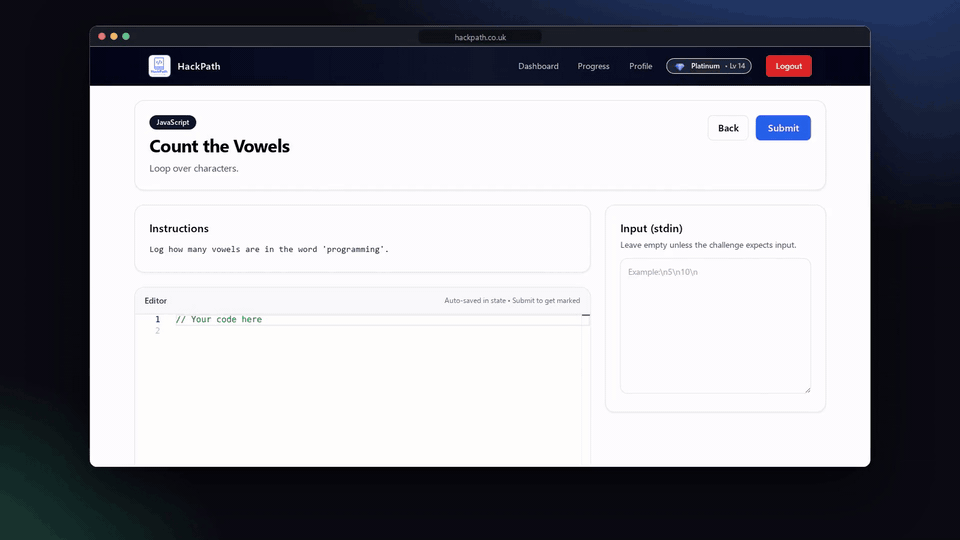
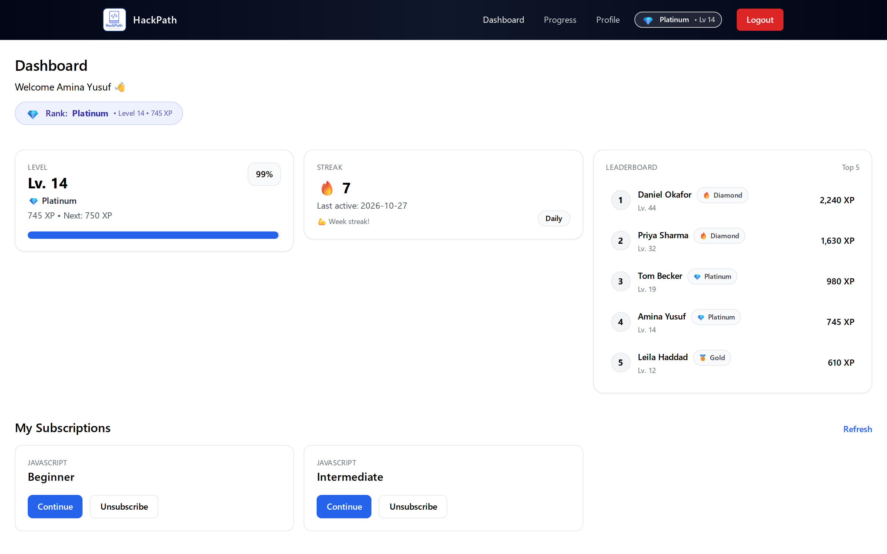
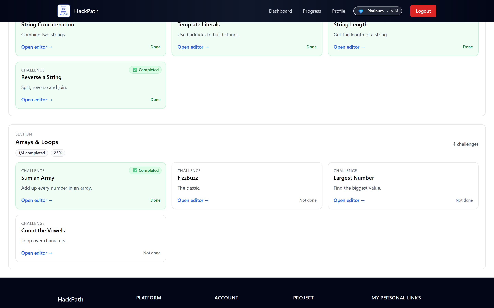
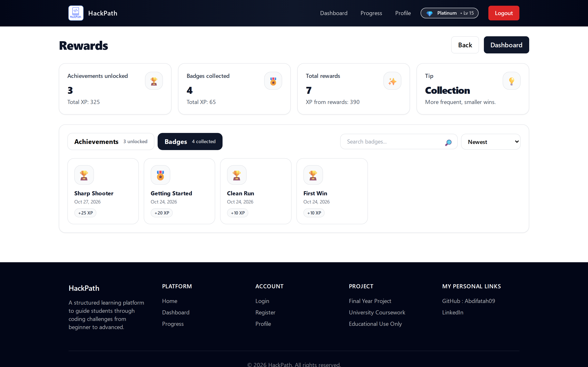
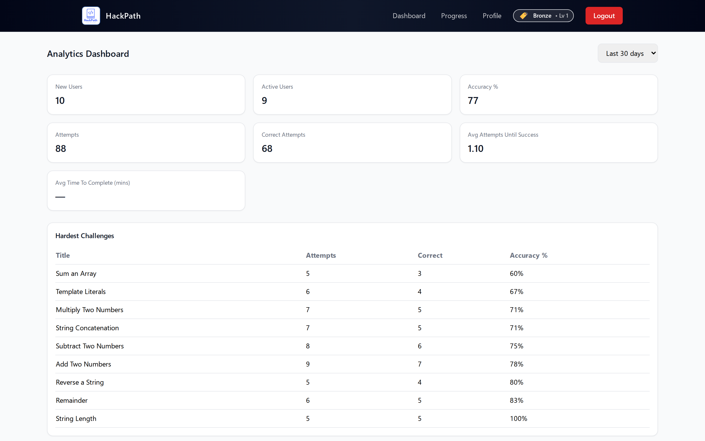
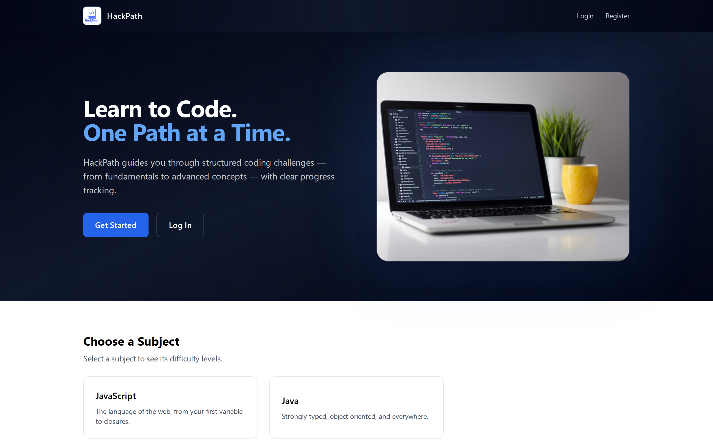

# HackPath

**A gamified coding platform where you learn to program by solving challenges, earning XP and climbing the leaderboard.**

🔗 **Try it live: [hackpath.co.uk](https://www.hackpath.co.uk)**


HackPath started as my final-year project. Sign up, pick a subject and difficulty, and solve challenges in a code editor in the browser. Your code runs in a sandbox, its output is compared with the challenge's reference solution, and you get feedback straight away. Each solve earns XP, keeps your streak going and counts toward badges and achievements.

## Features

- **In-browser code editor.** Monaco, the editor behind VS Code, with JavaScript and Java support.
- **Real code execution.** Submissions run in a sandbox through [Judge0](https://judge0.com) and their output is compared with the challenge's reference solution.
- **Structured learning paths.** Subjects → difficulties → sections → challenges, with progress tracked at every level.
- **Gamification.** XP and levels, ranks, daily streaks, badges, achievements and a global leaderboard.
- **Admin tools.** Curriculum management and an analytics dashboard for instructors.
- **Production hardening.** JWT access and refresh tokens, rate limiting, Helmet security headers and a CORS allow-list.
- **Tested.** Backend API covered by Jest and Supertest.

## Screenshots

| Solve a challenge, get marked instantly | Your dashboard |
|---|---|
|  |  |

| Learning paths | Badges and achievements |
|---|---|
|  |  |

| Admin analytics | Home |
|---|---|
|  |  |

## Tech stack

| Layer    | Tech |
|----------|------|
| Frontend | React 19, Vite, Tailwind CSS, React Router, Monaco Editor |
| Backend  | Node.js, Express 5, Sequelize |
| Database | PostgreSQL |
| Code execution | Judge0 |
| Hosting  | Vercel (frontend) |

## Project structure

```
backend/    Express API: controllers, routes, Sequelize models, seeders, Jest tests
frontend/   React + Vite app: pages, components, services, auth context
```

## Running it locally

**Prerequisites:** Node.js 20+ and PostgreSQL.

### Backend

```bash
cd backend
npm install
```

Create `backend/.env`:

```env
PORT=4000
JWT_SECRET=change-me
DB_HOST=localhost
DB_PORT=5432
DB_USER=postgres
DB_PASSWORD=postgres
DB_DATABASE=fyp_db
FRONTEND_URL=http://localhost:5173

# Judge0 (defaults to the public instance at ce.judge0.com)
JUDGE0_BASE_URL=
JUDGE0_USE_RAPIDAPI=false
JUDGE0_RAPIDAPI_KEY=
JUDGE0_RAPIDAPI_HOST=

# Only needed for password-reset emails
POSTMARK_SERVER_TOKEN=
```

Then:

```bash
npm run seed:all   # load starter challenges, badges and achievements
npm run dev        # API on http://localhost:4000
npm test           # run the test suite
```

### Frontend

```bash
cd frontend
npm install
cp .env.example .env   # points at the API on localhost:4000
npm run dev            # app on http://localhost:5173
```

## Screenshots and videos

Everything in `docs/` is recorded by a script from a local copy filled with demo data, so it can be redone
after UI changes. It needs a throwaway Postgres database with "demo" in its name (it's wiped before every
clip) and uses Segoe UI from `/mnt/c/Windows/Fonts` when run under WSL:

```bash
cd scripts/promo && npm install && npx playwright-core install chromium-headless-shell
DB_DATABASE=hackpath_demo DB_HOST=localhost DB_USER=postgres DB_PASSWORD=postgres npm run record
npm run record -- shots tour   # or just some of: shots tour teaser solving
```

It writes the README screenshots to `docs/` and the GIFs, MP4s, framed screenshots and a 1280×640 social
preview card to `docs/media/`.

## Author

**Abdifatah Abdi Mohamed**
[GitHub](https://github.com/Abdifatah09) · [LinkedIn](https://www.linkedin.com/in/abdifatah-abdi-mohamed-a419b92a2/)
